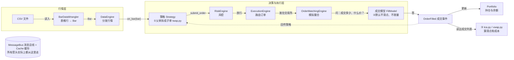
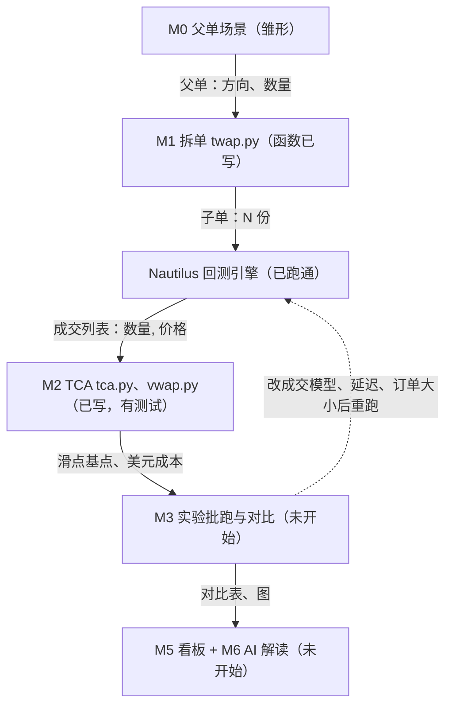

# ExecScope 框架图

GitHub 会把下面的 mermaid 代码渲染成图。更好看的版本在交互笔记页的“框架”标签（notes/execscope-notes.html）。

## 图 1：一笔订单在引擎里怎么走

## 图 2：ExecScope 的流程

## 三层心智模型
1. **行情层**：CSV → BarDataWrangler → DataEngine，把历史数据变成引擎认识的 Bar，按时间送给策略。
2. **决策与执行层**：策略 → 风控 → 执行引擎 → 撮合引擎 + 成交模型，决定买不买，以及成交多少、什么价。
3. **账户与分析层**：OrderFilled → Portfolio；ExecScope 从成交算 TCA。

## 你做过的事在图里的位置
| 做的事 | 对应位置 | 学到什么 |
|---|---|---|
| 跑通 example_01 | 图 1 整条链路 | 回测需要引擎、交易所、品种、数据、策略 |
| peek_bar.py | BarDataWrangler | 表格行被翻译成 Bar |
| order_strategy.py | 策略 → 风控 → 执行 → 撮合 | 下单后出现 OrderSubmitted、OrderFilled |
| 买 1 / 1000 / 10000 手 | 成交模型（②） | 默认每手多付约 1 个最小价位 |
| tca.py | ③ / M2 | 成交列表 → 滑点和成本 |
| twap.py | ① / M1 | 父单平均拆成 N 份 |
| vwap.py | M2 | 成交量加权均价 |

每做完一步，用自己的话回答：这一步在图里哪个位置？输入是什么？输出是什么？
